# Automatic CI/CD Deployment with Jenkins, GitHub Webhooks and Docker on AWS EC2

**Project Type:** DevOps Internship Project  
**Organization:** Uyartechnologies  
**Role:** Intern – DevOps Engineer

## 1. Project Overview

This project automated the deployment of a web application on an AWS EC2 instance running Amazon Linux 2023.

Before the change, a developer had to open Jenkins and click **Build Now** after every push. After the change, a push to GitHub starts a Jenkins pipeline automatically. The pipeline pulls the latest code, builds a Docker image, runs checks, deploys the container and verifies it with an HTTP health check, similar to the Netlify / Vercel experience.

The project covered Jenkins installation, repository credentials, Jenkins pipelines, GitHub webhooks, branch filtering, Docker deployment, failure reporting and troubleshooting.

**Confidentiality:** Client-identifying information, private source code, credentials and server details are excluded from this repository.

## 2. Objectives

- Install and configure Jenkins on AWS EC2.
- Trigger Jenkins automatically from GitHub push events.
- Restrict automatic deployment to one branch.
- Build, test and deploy the application with Docker.
- Verify every deployment with a health check.
- Make failed builds clearly visible and never report them as successful.
- Prevent overlapping deployments.
- Keep manual builds available for troubleshooting.
- Keep secrets out of source code.

## 3. Technology Stack

| Component | Technology |
| --- | --- |
| Cloud Platform | AWS EC2 |
| Operating System | Amazon Linux 2023 |
| CI/CD Server | Jenkins (LTS) |
| Jenkins Plugins | Pipeline, Git, Credentials Binding, Timestamper, Generic Webhook Trigger |
| Containerization | Docker |
| Runtime | Java 21 |
| Source Control | Git, GitHub |
| Trigger | GitHub Webhooks (push event) |
| Testing | Linux CLI, curl, Jenkins console logs |

## 4. Architecture

```
   Developer
       |
       |  git push
       v
     GitHub
       |
       |  Webhook (push event, JSON)
       v
 Jenkins Generic Webhook Trigger
       |
       |  Branch filter on the pushed ref
       v
 Jenkins Pipeline
   1. Checkout latest code
   2. Build Docker image
   3. Test and validate
   4. Deploy container
   5. Health check (HTTP 200)
       |
       v
 Build status: SUCCESS or FAILURE

   AWS EC2 Instance
   Amazon Linux 2023
```

### Architecture Explanation

1. A developer pushes code to GitHub.
2. GitHub sends a webhook request to Jenkins.
3. The Generic Webhook Trigger reads the pushed branch from the payload and compares it with the allowed branch.
4. If the branch matches, Jenkins starts the pipeline.
5. The pipeline builds, tests and deploys the Docker container.
6. A health check confirms that the new version responds with HTTP 200.
7. The build is marked successful or failed in Jenkins.

## 5. AWS EC2 and Jenkins Setup

### Activities Performed

- Launched an EC2 instance and connected with EC2 Instance Connect.
- Installed Java 21, Git, Docker and Jenkins.
- Started and enabled the Docker and Jenkins services.
- Completed the Jenkins first-time setup and installed the required plugins.

### Example Commands

```bash
sudo dnf update -y
sudo dnf install -y java-21-amazon-corretto git docker

# Jenkins repository and install
sudo wget -O /etc/yum.repos.d/jenkins.repo https://pkg.jenkins.io/redhat-stable/jenkins.repo
sudo rpm --import https://pkg.jenkins.io/redhat-stable/jenkins.io-2023.key
sudo dnf install -y jenkins

sudo systemctl enable --now docker
sudo systemctl enable --now jenkins

# Allow Jenkins to run Docker commands
sudo usermod -aG docker jenkins
sudo systemctl restart jenkins
```

Verify the tools:

```bash
java -version
git --version
sudo docker --version
sudo systemctl is-active jenkins
```

**Observed result during testing:** Java 21, Git 2.50, Docker 25.0 and the Jenkins service were all reported as installed and active.

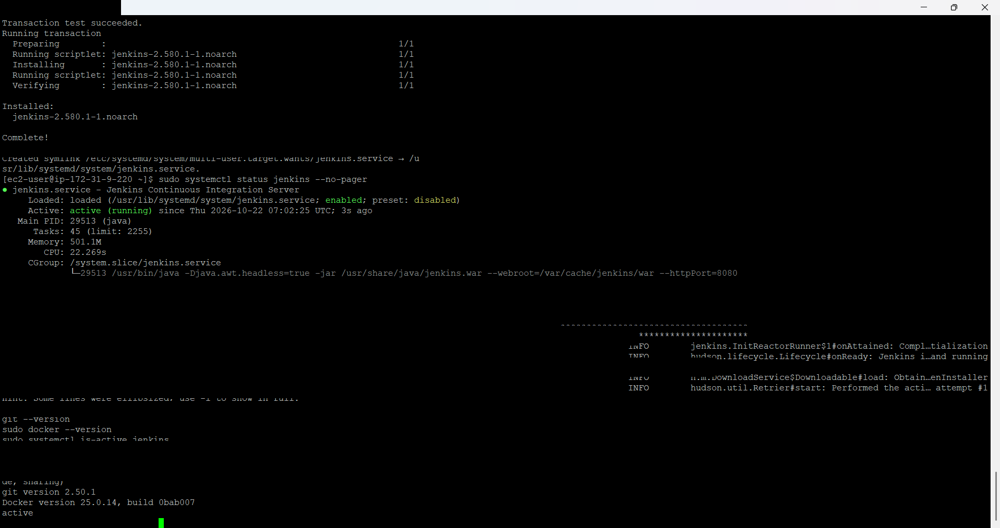

Open `http://<JENKINS_HOST>:8080`, unlock Jenkins with the initial admin password, install the suggested plugins and create the admin user. Then install **Generic Webhook Trigger** from *Manage Jenkins > Plugins*.

## 6. Repository Credential

A credential was added in *Manage Jenkins > Credentials > Global > Add Credentials*:

| Setting | Value |
| --- | --- |
| Kind | Username with password |
| Username | `<GITHUB_USERNAME>` |
| Password | GitHub personal access token with read access |
| ID | `<CREDENTIAL_ID>` |

The pipeline must use exactly this ID. A wrong ID fails the Checkout stage with *"CredentialId ... could not be found"*.

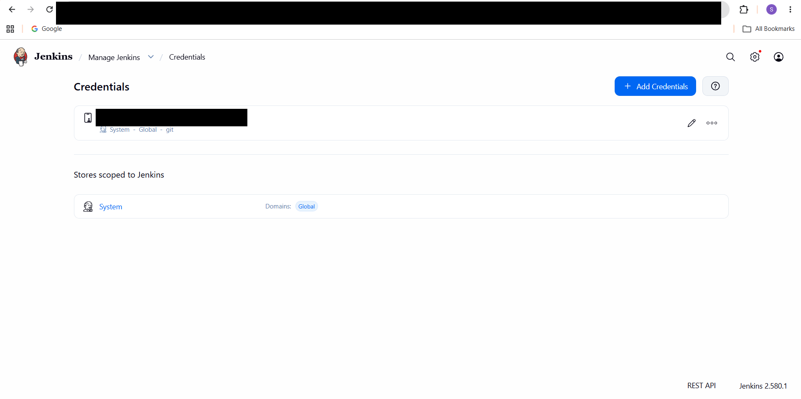

## 7. Jenkins Pipeline

A **Pipeline** job was created for the frontend and one for the backend. A simplified example of the pipeline script is shown below. It is an illustration of the structure, not the original project script.

```groovy
pipeline {
    agent any

    options {
        timestamps()
        disableConcurrentBuilds()      // no two deployments at the same time
        timeout(time: 30, unit: 'MINUTES')
    }

    environment {
        REPO_URL       = 'https://github.com/<ORG>/<REPO>.git'
        BRANCH         = '<DEPLOY_BRANCH>'
        IMAGE_NAME     = '<IMAGE_NAME>'
        TEST_CONTAINER = '<IMAGE_NAME>-ci-test'
    }

    stages {
        stage('Checkout') {
            steps {
                git branch: env.BRANCH, url: env.REPO_URL, credentialsId: '<CREDENTIAL_ID>'
            }
        }
        stage('Build Image') {
            steps { sh 'docker build -t $IMAGE_NAME:latest .' }
        }
        stage('Test') {
            steps {
                sh '''
                    set -eu
                    docker rm -f $TEST_CONTAINER || true
                    docker run -d --name $TEST_CONTAINER -p 8081:80 $IMAGE_NAME:latest
                    for i in 1 2 3 4 5 6 7 8 9 10; do
                        CODE=$(curl -sS -o /dev/null -w '%{http_code}' http://127.0.0.1:8081/ || true)
                        [ "$CODE" = "200" ] && break
                        sleep 2
                    done
                    [ "$CODE" = "200" ]
                '''
            }
        }
        stage('Deploy') {
            steps {
                sh '''
                    # see "Deployment" section below
                '''
            }
        }
    }

    post {
        always { sh 'docker rm -f $TEST_CONTAINER >/dev/null 2>&1 || true' }
    }
}
```

### Key Points

- `set -eu` makes any failing command fail the stage, so a broken build is never reported as successful. Later stages are skipped automatically.
- `disableConcurrentBuilds()` prevents two pushes from deploying at the same time.
- The temporary test container is always removed in `post`.
- Other containers, such as a database, are never touched by the application deployment.

A verification-only pipeline, used for a service that must not be replaced automatically, has these stages:

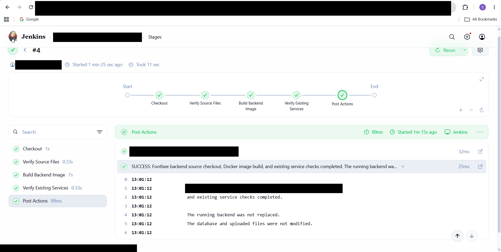

## 8. GitHub Webhook and Branch Filtering

### 8.1 GitHub Webhook

A webhook was added in the repository under *Settings > Webhooks > Add webhook*:

| Setting | Value |
| --- | --- |
| Payload URL | `http://<JENKINS_HOST>:8080/github-webhook/` |
| Content type | `application/json` |
| Secret | set one if possible |
| SSL verification | enabled (use HTTPS in production) |
| Events | Just the `push` event |

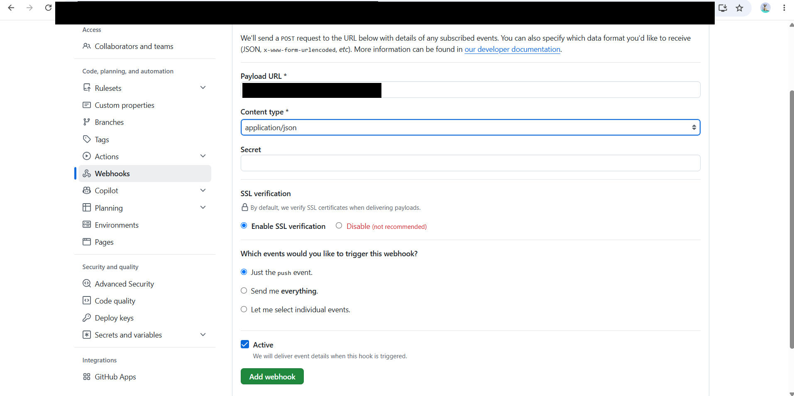

GitHub sends a **ping** when the webhook is created. *Recent Deliveries* shows **Response 200** when Jenkins is reachable:

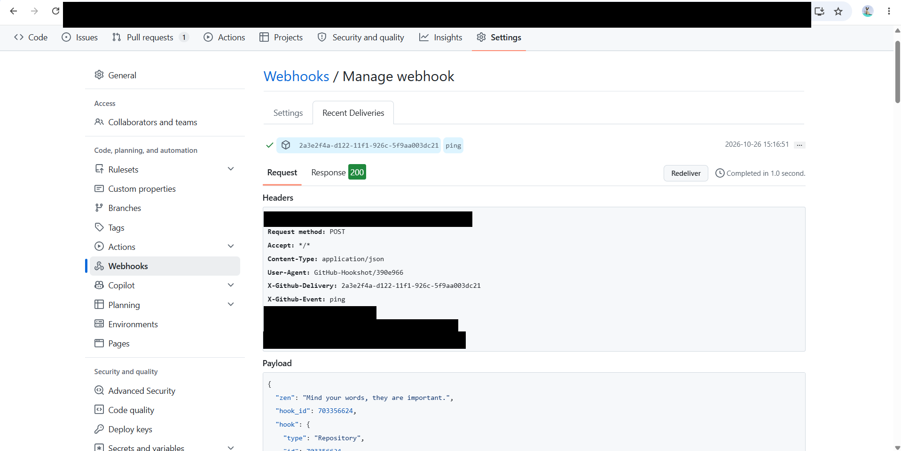

### 8.2 First Automatic Build

With **GitHub hook trigger for GITScm polling** enabled in the job, a push to the repository started a Jenkins build with no manual action. The build cause shows **Started by GitHub push**:

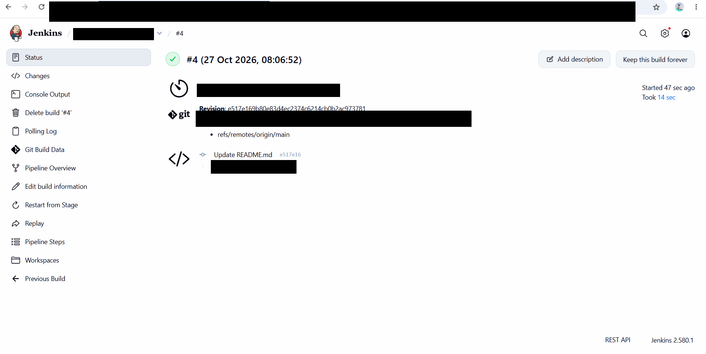

### 8.3 Branch Filtering with Generic Webhook Trigger

The GitHub-plugin trigger does not filter by branch for a normal Pipeline script job. To restrict deployments to one branch, the **Generic Webhook Trigger** plugin was installed and enabled in the job's **Build Triggers**:

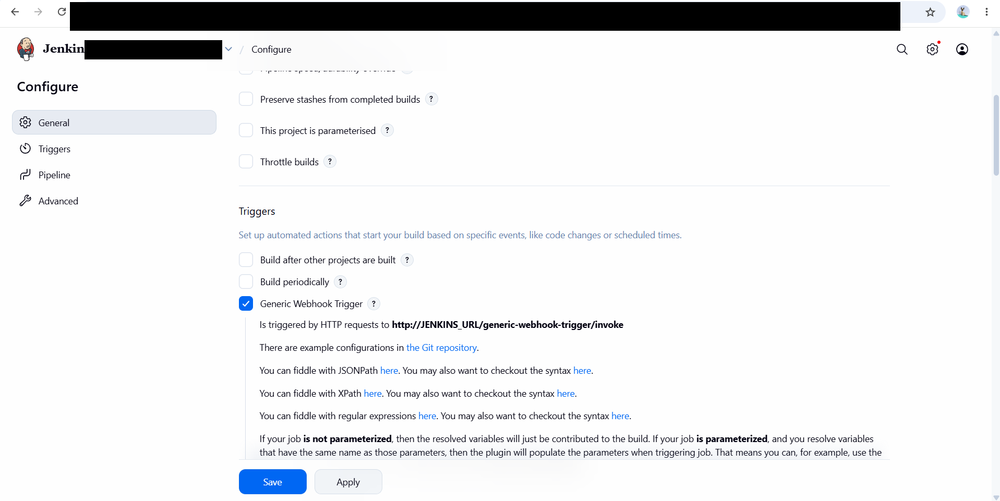

| Setting | Value |
| --- | --- |
| Post content parameter, Variable | `ref` |
| Post content parameter, Expression | `$.ref` (JSONPath) |
| Token | `<TOKEN>` (long and random) |
| Optional filter, Text | `$ref` |
| Optional filter, Expression | `^refs/heads/<DEPLOY_BRANCH>$` |

The optional filter restricts deployments to one branch. A push to any other branch is received by Jenkins but does not start the build.

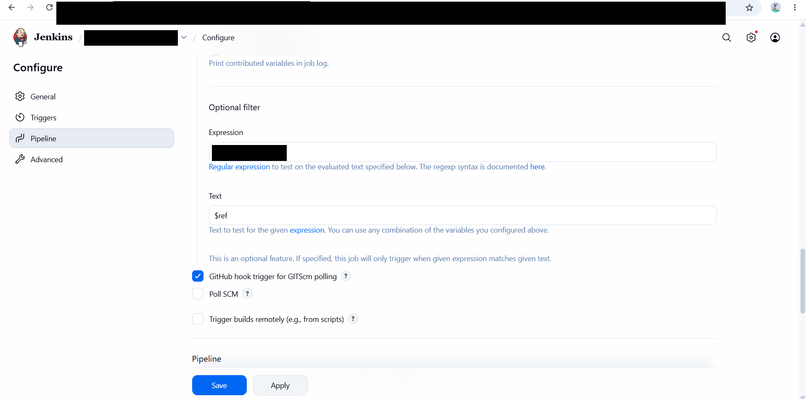

A second webhook was added in GitHub that points to the Generic Webhook Trigger endpoint:

| Setting | Value |
| --- | --- |
| Payload URL | `http://<JENKINS_HOST>:8080/generic-webhook-trigger/invoke?token=<TOKEN>` |
| Content type | `application/json` |
| Events | Just the `push` event |

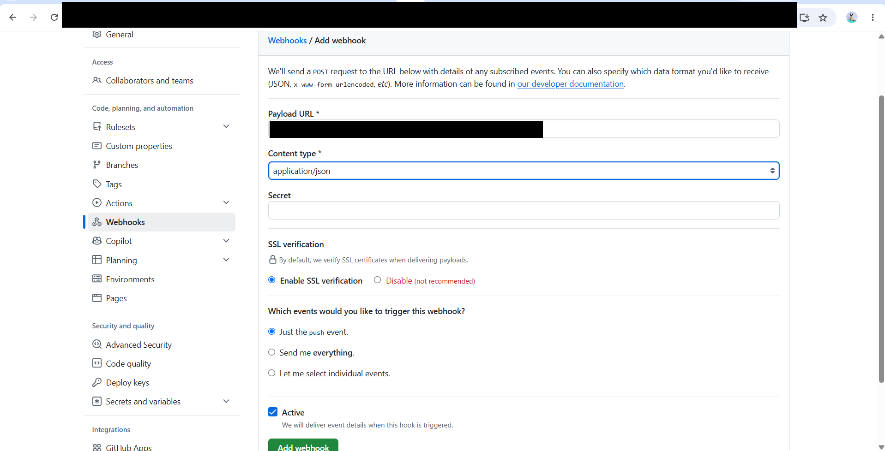

After this, pushes start builds with the cause **Generic Cause**:

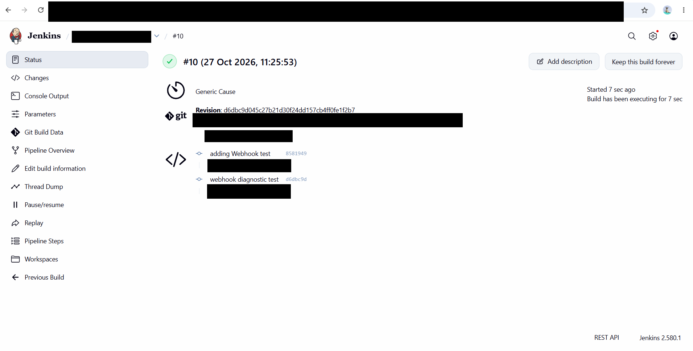

### 8.4 Old Trigger

If the job also has **GitHub hook trigger for GITScm polling** enabled and the original `/github-webhook/` hook still exists, that path has no branch filter. It should be removed so that only the filtered trigger can start the job.

## 9. Deployment

The deploy stage replaces only the application container and verifies it before the build is reported as successful.

```bash
set -eu

# keep the running image so we can roll back
docker tag $IMAGE_NAME:current $IMAGE_NAME:previous 2>/dev/null || true
docker tag $IMAGE_NAME:latest  $IMAGE_NAME:current

# replace only the application container (never the database or other services)
docker rm -f <APP_CONTAINER> || true
docker run -d --name <APP_CONTAINER> -p 80:80 --restart unless-stopped $IMAGE_NAME:current

# health check: wait for HTTP 200
ok=0
for i in 1 2 3 4 5 6 7 8 9 10; do
  CODE=$(curl -sS -o /dev/null -w '%{http_code}' http://127.0.0.1/ || true)
  [ "$CODE" = "200" ] && ok=1 && break
  sleep 2
done

# roll back and fail the build if the new version is not healthy
if [ "$ok" != "1" ]; then
  echo "Health check failed - rolling back"
  docker rm -f <APP_CONTAINER> || true
  docker run -d --name <APP_CONTAINER> -p 80:80 --restart unless-stopped $IMAGE_NAME:previous || true
  exit 1
fi
echo "Deployed successfully: HTTP $CODE"
```

**Note:** The rollback logic is an example template. It was not part of the screenshots below and should be tested before use.

### Benefits

- No manual step: the deployment runs from the webhook-triggered build.
- The build is green only if the health check returns HTTP 200.
- A failed health check restores the previous image and fails the build.
- Only the application container is replaced.
- `disableConcurrentBuilds()` prevents overlapping deployments.

Result of a successful deployment (stage view and console):

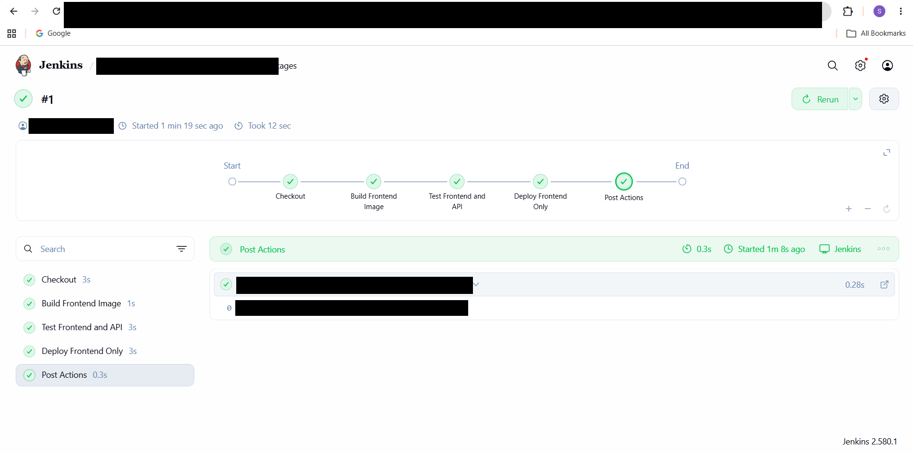

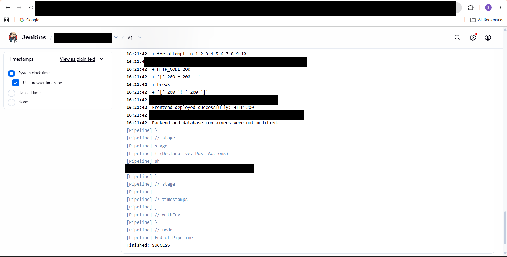

For a service that must not be replaced automatically, the pipeline only verifies it and states in the log that the running service was not touched:

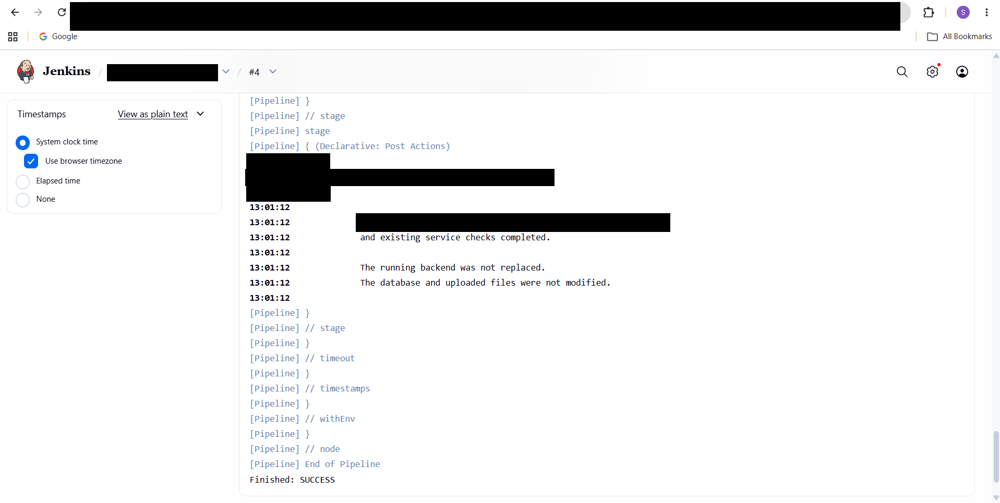

The application and its API also responded through the reverse proxy (an empty list is returned when there is no data yet):

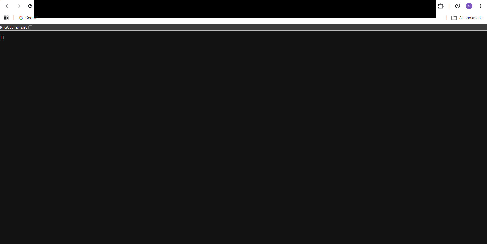

## 10. Testing and Verification

### Automatic Trigger Tests

1. A small commit was pushed to the deployment branch.
2. Jenkins started a build by itself: first as **Started by GitHub push**, and after the Generic Webhook Trigger was added as **Generic Cause** (screenshots in Section 8).
3. GitHub *Recent Deliveries* showed **Response 200** for each push.
4. The Jenkins console ended with `Finished: SUCCESS` and the health check returned HTTP 200.

### Failure Visibility

A build that fails is reported as failed, the later stages are skipped and the running application is left unchanged:

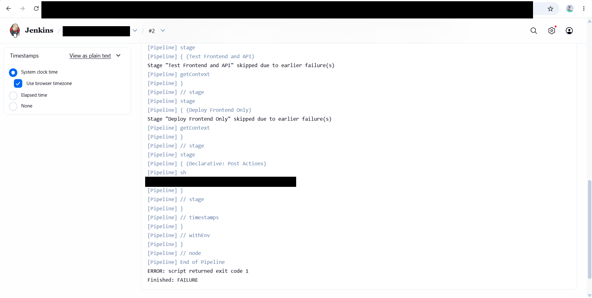

Build history shows the failed build in red while later builds continue normally:

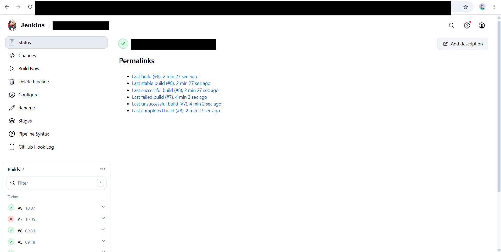

### Functional Test Results

| Test Case | Result |
| --- | --- |
| Jenkins, Java, Git and Docker installed and active | Verified |
| Manual pipeline build, test and deploy | Verified |
| GitHub webhook ping reaches Jenkins (HTTP 200) | Verified |
| Push to the deployment branch starts a build automatically | Verified |
| Generic Webhook Trigger with branch filter | Verified |
| Failed build reported as failed and later stages skipped | Verified |
| Application health check (HTTP 200) after deployment | Verified |
| Other services unchanged by the application deployment | Verified |
| Manual **Build Now** still available | Verified |
| Push to a non-deployment branch does not start a build | Not yet tested |

These results describe what was tested during the project. They should not be read as a guarantee that every scenario was covered.

## 11. Troubleshooting and Resolutions

### Issue 1: Jenkins Node Offline

**Problem:** Builds waited at "Waiting for next available executor". The built-in node was taken offline because free space on `/tmp` dropped below 1 GiB.

**Resolution:** Free space was recovered on `/tmp` and the node was brought back online. Disk and temp space should be monitored on small instances.

### Issue 2: Credential Not Found

**Problem:** The Checkout stage failed with *"CredentialId ... could not be found"*.

**Resolution:** The pipeline was changed to use the exact credential ID saved in Jenkins.

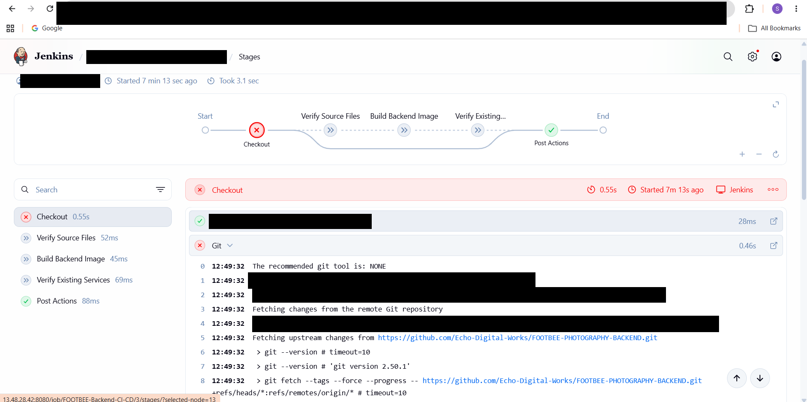

### Issue 3: Missing Dockerfile on the Branch

**Problem:** A build failed because the branch had no Dockerfile. Jenkins marked the build as failed, skipped the test and deploy stages and left the running application unchanged.

**Resolution:** The Docker configuration files were added to the branch, and the next build passed.

### Issue 4: Wrong Branch Content

**Problem:** After deployment the live site showed only the default starter page, because the default branch did not contain the complete application.

**Resolution:** On the senior's guidance the pipeline was pointed to the branch that contains the full application.

### Issue 5: Empty Branch Filter

**Problem:** A webhook response from Jenkins showed an empty filter expression.

**Resolution:** The branch filter was corrected in the job configuration.

### Issue 6: Trigger Without Branch Filter

**Problem:** The older GitHub-plugin trigger has no branch filter.

**Resolution:** The Generic Webhook Trigger with a `$ref` filter was used for branch control, and the older trigger should be disabled.

## 12. Useful Commands

```bash
# Jenkins service
sudo systemctl status jenkins
sudo journalctl -u jenkins -n 100 --no-pager

# Docker
docker ps
docker ps -a
docker images
docker logs <APP_CONTAINER>

# Health check
curl -I http://127.0.0.1/

# Disk and temp space
df -h /tmp
```

## 13. Security Considerations

- Keep tokens, passwords and keys only in **Jenkins Credentials**, never in the pipeline script or repository.
- Use a long random webhook token and set a webhook secret. Prefer sending the token in a header instead of the URL.
- Put Jenkins behind HTTPS.
- Protect the deployment branch in GitHub so only reviewed changes trigger a deployment.
- Restrict the EC2 security group to what is needed and keep Jenkins and plugins updated.
- Use an Elastic IP or a DNS name, because webhook URLs break if the public IP changes.

## 14. Key Learnings

This project provided hands-on experience with:

- Installing and configuring Jenkins on AWS EC2.
- Building declarative Jenkins pipelines for Docker applications.
- Triggering builds from GitHub webhooks and filtering by branch.
- Verifying deployments with health checks.
- Reporting failures clearly and preventing overlapping deployments.
- Managing credentials securely in Jenkins.
- Troubleshooting using Jenkins console logs, GitHub webhook deliveries and Linux commands.
- Documenting a CI/CD workflow.

## 15. Conclusion

This internship project strengthened my practical understanding of CI/CD automation with Jenkins, GitHub webhooks and Docker on AWS EC2.

It gave me hands-on exposure to pipeline design, webhook-based triggers, branch filtering, deployment verification, failure handling and troubleshooting.

## 16. Confidentiality Notice

This repository contains sanitized technical documentation for professional portfolio and learning purposes.

It excludes client-identifying information and does not contain confidential source code, credentials, access tokens, server addresses or other restricted materials. All names and addresses shown are placeholders, and screenshots have been cropped or redacted.
